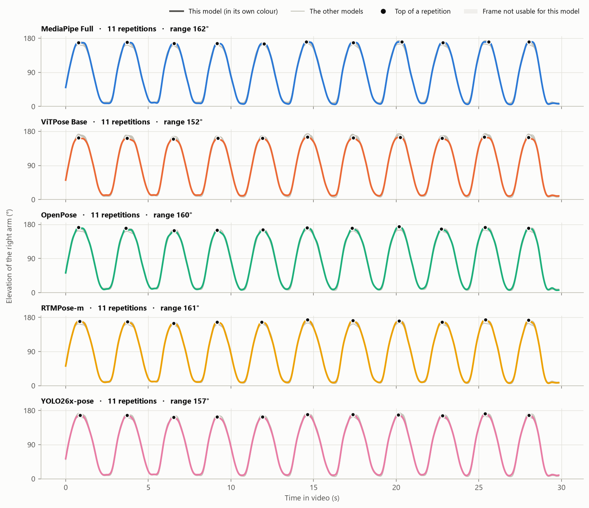
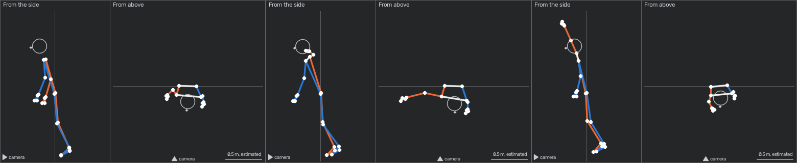

# MobiPhysio pose comparison

Tools for the first step of a mobile physiotherapy assistant built on the
[MobiPhysio dataset](https://doi.org/10.7910/DVN/XSI0QN): getting body joint positions out
of exercise videos. Five pose estimation models can be run on the same video, watched side
by side, and compared in a report.

The work so far covers one of the dataset's nine exercises, E01 Abduction (raising the arm
sideways).

There is no ground truth for joint positions in the dataset. The tools show how the models
differ from each other, how often each gives usable frames, and how fast each runs. They
do not show which model is correct, and they say nothing about whether an exercise was
performed correctly.



*One 30-second clip, five models: the arm's elevation over time, with the repetitions each model counted.*



*MediaPipe's 3D points with the arm down, level and overhead, each drawn from the side and from above.*

## What is in this repository, and what is not

| In the repository | Not in the repository | Why not |
|---|---|---|
| The code (`demo.py`, `poselab/`, `scripts/`) | The videos, and every image, recording or report made from them | They show participants' faces |
| The plan and two reports (`docs/`) | Pose tracks, score sheets and tables per clip | They are made from the dataset; see `data/README.md` |
| The list of model files with sources, licences and checksums (`models/sources.json`) | The model weights themselves | Large, and each has its own licence. `setup.bat` downloads them |
| Which participants are held back for the final test (`data/meta/participant_splits.csv`) | | |

The documents mention paths under `data/`, `outputs/`, `archive/` and `models/`. Those
folders exist on the computer the work was done on; `archive/` holds superseded material
and is not needed to run anything.

## Setting up

Needs Windows, Python 3.11, about 6 GB of free disk space and, for four of the five
models, an NVIDIA graphics card with a recent driver. [uv](https://docs.astral.sh/uv/) is
used when it is installed, otherwise pip.

**One step:** double-click `setup.bat`. It creates `.venv`, installs the packages listed in
`requirements.txt`, and downloads the model weights (about 0.9 GB).

The same by hand:

```
uv venv .venv --python 3.11
uv pip install --python .venv\Scripts\python.exe --no-deps --index-strategy unsafe-best-match -r requirements.txt
.venv\Scripts\python scripts\download_models.py
```

or, without uv:

```
py -3.11 -m venv .venv
.venv\Scripts\python -m pip install --no-deps -r requirements.txt
.venv\Scripts\python scripts\download_models.py
```

- **`--no-deps` is needed.** Two of the packages ask for a second copy of OpenCV and of ONNX Runtime, which would overwrite parts of the ones the project uses. `requirements.txt` already lists every package that is needed, with exact versions.
- **The weights are not Python packages**, so `requirements.txt` cannot install them. `scripts/download_models.py` fetches them, and the program also fetches any that are still missing the first time a model is used. `--list` shows what is present without downloading anything.
- **Each downloaded file is compared with `models/sources.json`**, the record of the files the project was developed with. A difference is reported.
- **Tried on one computer only**, the one the project was developed on (Windows 11, Ryzen 7 7700, RTX 4060 Ti). Linux and macOS have not been tried.

## Getting the data

The videos are not included. `data/README.md` says where the dataset is published, where
each file goes, and two faults found in the published copy that the scripts check for.

## Try a video

1. Double-click `run_demo.bat`. A small window opens.
2. Press **Choose...** and pick a video (it starts in the `data` folder).
3. Tick the models you want. All five are ticked to begin with.
4. The camera view is read from the file name (`_AF_` front, `_AL_` and `_AR_` side). Set it by hand for any other video.
5. Leave **Hands** ticked to also find the fingers and read whether each hand is open or closed (see "Hands" below).
6. Press **Start**. The first run takes about ten seconds longer while the models load.

A second window shows the video once per model with the skeleton drawn on it, and a
chart of the arm's elevation that grows as the video plays. When MediaPipe is ticked, one
more panel shows its 3D skeleton from the side and from above (see "MediaPipe in 3D"
below). **Space** pauses, **Q** stops early. Measured on the development computer on
2026-10-12: with all five models and hands, a 30-second clip takes about two minutes
(7 frames per second); without hands, about one and a half minutes (9 to 10 frames per
second). One model on its own, without hands or the live window, ran at 27 to 43 frames
per second, which is about the speed of the video.

When the video ends, the report opens in your browser. Every run gets its own folder in
`outputs/demo/`, named after the video and the time:

| File | What it is |
|---|---|
| `report.html` | The report: summary, movement, agreement, usable frames, speed, sample frames |
| `live_view.mp4` | A recording of the live window (also shown inside the report) |
| `frames.jpg` | Six frames with every model's skeleton |
| `hands.jpg` | Enlarged cut-outs of both hands with the fingers that were found |
| `space.jpg` | Six frames with MediaPipe's 3D skeleton from the side and from above |
| `figures/` | The charts as images |
| `summary.csv`, `agreement.csv`, `signals.csv`, `hands.csv`, `space.csv`, `space_signals.csv` | The numbers behind the report |
| `pose/<model>.npz`, `pose/hands.npz` | Every point of every frame, as each model returned it. MediaPipe's file also holds its 3D points (`world`) |

The same from a terminal:

```
.venv\Scripts\python demo.py --video "data\E01(Abduction)\E01_P02_AF_VFL_GM.mp4"
.venv\Scripts\python demo.py --video <file> --models mediapipe rtmpose --view front
.venv\Scripts\python demo.py --video <file> --no-window --no-record --no-hands
```

Videos of the eleven participants held back for the final test are refused (see "Rules
that protect the final test" below).

## The five models

| Model | How it works | Points | Feet | 3D | Runs on | Licence of the weights |
|---|---|---|---|---|---|---|
| MediaPipe Pose Landmarker, Full | Finds the person once, then tracks them | 33 | yes | yes | CPU | Apache-2.0 |
| ViTPose Base (whole-body version) | Top-down: a person detector, then a vision transformer on the cut-out person | 23 | yes | no | GPU | Apache-2.0 |
| OpenPose (25-point body model) | Bottom-up: finds all body points, then joins them into people | 25 | yes | no | GPU | Non-commercial research only |
| RTMPose-m (26-point) | Top-down, built for speed | 26 | yes | no | GPU | Apache-2.0 |
| YOLO26x-pose | One-stage: boxes and points for everyone from one network | 17 | no | no | GPU | AGPL-3.0 |

- OpenPose here is CMU's original trained network and definition (checksum matches CMU's), run by code written for this project instead of CMU's own program. See `docs/pose_models.md`.
- ViTPose's file is a community conversion of the authors' whole-body model. It has no official checksum; it was checked against the officially hosted ViTPose++ Base instead. See `docs/pose_models.md`.
- OpenPose and YOLO26 cannot be shipped in an app without a commercial licence (or, for YOLO26, releasing the app under AGPL-3.0). They are here for comparison.
- Details, measurements and the reasons for each choice: `docs/pose_models.md`.

## Hands

Pose models stop at the wrist. With **Hands** ticked, a separate hand model (MediaPipe Hand
Landmarker, 21 points per hand) looks at an enlarged cut-out around each wrist and the
program reports each hand as open, partly closed or closed.

- It works with any of the five pose models, because it only needs the wrist position. Its result is the same whichever models are ticked.
- The live window shows both hands enlarged at the bottom right; the report has a "Hands" section.
- It finds the hand in most frames only in clear expert front-view clips (86% of frames in a scan of 108 clips; 31% in non-expert clips). Fast movement, low light, side views and small video lose it.
- It adds about 30 ms per frame. Untick it, or use `--no-hands`, to skip it.

Details and measurements: `docs/pose_models.md`, Section 7.

## MediaPipe in 3D

MediaPipe returns its 33 points a second time as positions in space, in metres around the
middle of the hips. The other four models give positions in the picture only.

- The live window shows the 3D skeleton in its own panel, from the side (camera on the left) and from above (camera at the bottom). The report has a section "MediaPipe Full in 3D".
- It appears whenever MediaPipe is ticked, and costs no noticeable time.
- The depth is the model's guess from one camera, not a measurement. In the 3D skeleton the upper arm comes out about a quarter shorter with the arm overhead than with the arm down, so use it to look, and keep the angles measured in the picture for range of movement.
- The report also gives the direction of the raised arm seen from above: 0° to the side, 90° to the front. In front-view clips it read "to the side" for abduction and picked out the one performance the judges rejected. It has not been tested on any other exercise.

Details and measurements: `docs/pose_models.md`, Section 8.

## Folders

| Folder | Contents | In the repository |
|---|---|---|
| `demo.py`, `run_demo.bat`, `setup.bat` | The pick-a-video program and the one-step setup | yes |
| `poselab/` | Shared code. `estimators/` has one file per model, all with the same interface; `hands.py` is the hand model; `analysis.py` holds the angles, quality checks and repetition counting; `space.py` holds the measures taken from 3D points; `report.py` builds the report; `weights.py` knows where each model file comes from | yes |
| `scripts/` | Dataset tools (manifest, participant splits, video checks), model download, and the Stage 1 pipeline for MediaPipe Full over many clips | yes |
| `docs/` | `feasibility_plan.md` (the staged plan), `stage1_report.md` (Stage 1 results), `pose_models.md` (the five models and this tool) | yes |
| `models/` | Model weights, one folder per model; `sources.json` lists where each file came from, its licence and checksum | `sources.json` only |
| `data/` | Videos (`E01(Abduction)/`), metadata (`meta/`), Stage 1 pose files (`pose/full_p1/`) | `README.md` and the participant split only |
| `outputs/demo/` | One folder per demo run | no |
| `outputs/stage1/` | Stage 1 tables, figures and overlay sheets for MediaPipe Full, and the 3D measures per clip | no |
| `archive/` | Things no longer in use: the MediaPipe Lite files, earlier model versions and early test runs | no |

## Stage 1 pipeline (MediaPipe Full over many clips)

```
.venv\Scripts\python scripts\extract_pose.py --videos data --exercise E01
.venv\Scripts\python scripts\stage1_tables.py --exercise E01
.venv\Scripts\python scripts\stage1_figures.py --exercise E01
.venv\Scripts\python scripts\overlay_sheets.py --videos data --exercise E01
.venv\Scripts\python scripts\stage1_space.py --exercise E01
```

These read and write the Stage 1 pose files in `data/pose/full_p1/` and use the same
analysis code as the demo. The last one measures MediaPipe's 3D points over all stored
clips without running any model (`outputs/stage1/full_p1/space_clips.csv` and
`space_summary.txt`).

## Rules that protect the final test

- Eleven participants are held back (the "lockbox", listed in `data/meta/participant_splits.csv`). Their clips are not analysed or viewed until the final test. The demo and the batch extractor both refuse them unless told otherwise on the command line.
- The videos and every image or report made from them show participants' faces. Keep them on the computer that holds the data.

## Sources

- **Dataset.** MobiPhysio: Data in Brief 65 (2026) 112635, https://doi.org/10.1016/j.dib.2026.112635 ; Harvard Dataverse, https://doi.org/10.7910/DVN/XSI0QN
- **Models.** Papers, model files and licences are listed in `docs/pose_models.md`, Section 14, and in `models/sources.json`.
