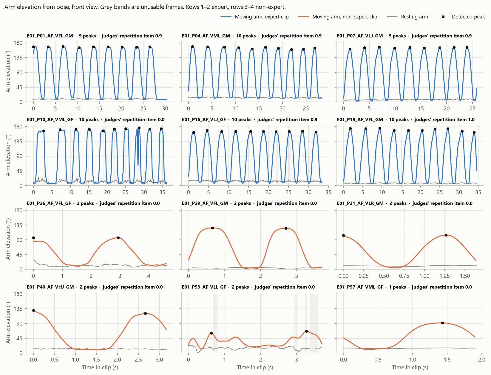
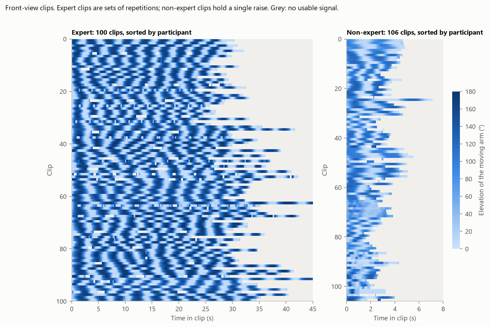
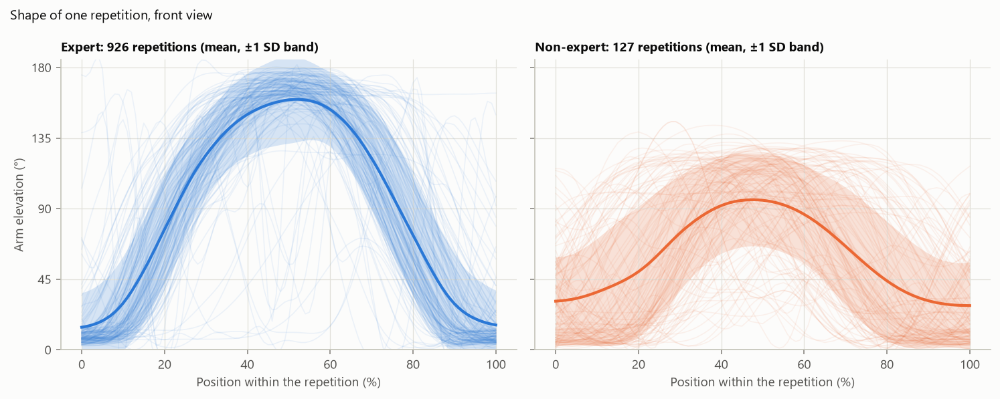
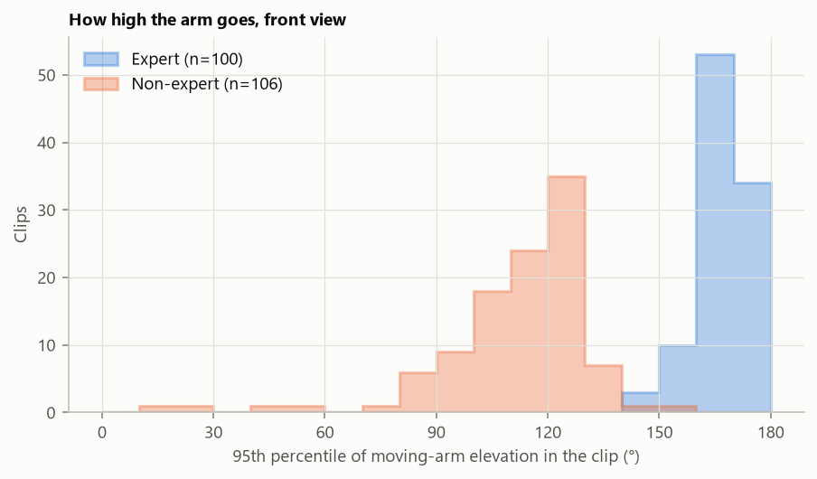
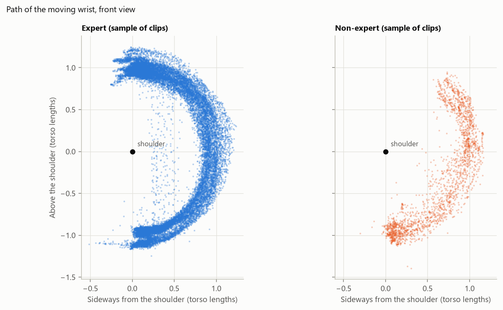
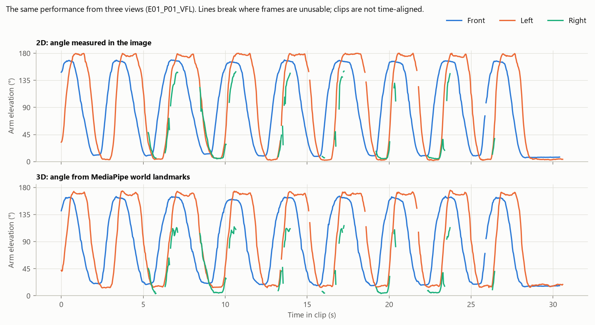

# Stage 1 report: can MediaPipe see abduction in the MobiPhysio E01 clips?

Written 2026-10-11. This report explains what was done, why each step was done that way, what came out, and what the results do and do not show. It follows the plan in `docs/feasibility_plan.md`.

> **Update, 2026-10-12.** The project continues with MediaPipe Full only, alongside four other pose models (see `docs/pose_models.md`). This report is kept as written, as the record of what Stage 1 measured with Lite and Full. What changed around it:
>
> - **Lite files moved.** The Lite pose files, tables, figures, overlay sheets, the Lite-against-Full comparison and the scripts exactly as they were run are in `archive/2026-10-12_lite/`. The figures shown in this report are the Lite ones; copies are in `docs/figures/stage1/` so that the report does not depend on the archive. The Full versions are in `outputs/stage1/full_p1/`.
> - **One flag renamed.** `low_visibility` is now called `low_confidence` in the code and tables. The check is the same.
> - **Scripts restructured.** The Stage 1 scripts now use the analysis code shared with the multi-model demo (`poselab/analysis.py`). After the change the Full tables came out identical to before: 436 clips and 3,032 repetition rows, the same text in all three files.
> - **Section 14 is updated** to the commands that work now.
> - **One remark in Section 9 is corrected.** I wrote that the flagged clip `E01_P10_AF_VML_GF` looked like a normal set of raises. MediaPipe's 3D points and two measures taken in the picture now both say the arm was raised to the front, not to the side. The note is at the end of Section 9; the evidence is in `docs/pose_models.md`, Section 8, and `outputs/stage1/full_p1/space_clips.csv`.

## 1. The short answer

- **Yes, on front-view clips.** MediaPipe finds a usable pose in almost every front-view E01 clip filmed in full or medium light, and the arm movement that defines abduction comes out as a clean, countable signal. Three of the four pass criteria set in the plan are met; the fourth needs your own counts (Section 9).
- **Before any of that, the file check found a serious problem with the public dataset.** On Dataverse, 370 of the 558 E01 filenames carry a different E01 video. Your copy has the right names. Everything here uses your copy.
- **The two cohorts are not doing the same thing.** Expert clips are 30-second sets of about ten raises to about 167°. Non-expert clips are 3-second snippets of one or two raises to about 118°. This matters more for the next stage than any pose result.
- **The Lite model fails silently on some dark non-expert clips.** It reports confident landmarks with the arm at the person's side while the arm is actually raised. The Full model does not. Only comparing the two models revealed it.
- **Side views work only when the moving arm is on the camera's side.** For experts, 71% of left-view clips are usable but only 27% of right-view clips, where the arm is hidden behind the body.
- **A passer-by breaks tracking.** Only 2 of 16 expert occlusion clips are usable from the front.
- **Nothing here measures classification accuracy, phone performance or clinical quality.** One exercise class cannot do the first, a desktop cannot do the second, and no label in this dataset supports the third.

Scope: pose analysis covers the 41 development participants only. The E01 clips of the 10 lockbox participants were hashed and had their container metadata read, but no pose was extracted from them and no frame was viewed.

## 2. Terms used

| Term | Meaning |
|---|---|
| Clip | One `.mp4` file |
| Cohort | Expert (P01–P24) or non-expert (P26–P62) |
| View | Front, left or right, from the filename |
| Variation | Recording condition from the filename: full light (FL), medium light (ML), low light (LL), low jitter (LJ), high jitter (HJ), occlusion (O), low resolution (LR) |
| Landmark | One of the 33 body points MediaPipe returns for each frame |
| Arm elevation | Angle between the upper arm and the trunk: 0° arm hanging, 90° horizontal, 180° overhead |
| Moving arm, resting arm | The arm whose elevation changes more in a clip, and the other one |
| Usable frame | A frame that passes all six quality checks in Section 6 |
| Usable clip | At least 80% usable frames and no run of unusable frames longer than 1 s |
| Lite, Full | Two sizes of the MediaPipe pose model; Lite is smaller and faster |

## 3. Step 0: check the files before trusting them

**What was done.** Every local clip was hashed (MD5, a fingerprint of the file's bytes) and compared with the fingerprint Dataverse publishes for the same filename.

**Why.** Every later step attaches meaning to the filename: participant (used to split data), view, variation, and the physiotherapists' scores. If names and videos are mismatched, all of that is silently wrong.

**What came out.** All 558 local files exist on Dataverse byte for byte, but only 188 sit under the same name. For the other 370, the same video has a different name on Dataverse.

**How the pattern was found.** Sorting the videos by file size showed that each of the 370 names carries, on Dataverse, the video one place larger than the one it carries in your copy. An off-by-one shift like this is what happens when a list of names and a list of files are paired after one of them gained or lost an entry.

**How the correct copy was identified.** A shift tells you the two copies disagree, not which is right. Three independent checks all favour your copy:

| Check | Under your names | Under Dataverse's names |
|---|---|---|
| The three views of one expert performance should last about equally long | Median difference 0.9 s; 88% within 2 s | Median difference 7.2 s; 19% within 2 s |
| Clips of one participant and view should come from one phone (same resolution, frame rate, codec) | 20 of 140 groups mixed | 48 of 140 groups mixed |
| Four clips viewed by eye: do gender, view, lighting and occlusion match the name? | 4 of 4 match | 0 of 4 match |

**Lesson.** Verify labels before modelling. A model trained on the Dataverse copy of E01 would have learned from clips whose participant, view, variation and score were wrong two times out of three, and nothing in the training output would have said so.

**What follows.** Use only the authors' copy. The other eight exercises on Dataverse have not been checked; when your copy of each arrives, `python scripts/build_manifest.py --videos data` repeats the comparison. Your copy has one defect of its own: `E01_P60_AF_VLR_GF` and `E01_P60_AF_VML_GF` are the same file. A second scan compared the landmark tracks of 426 clips to find re-encoded copies that a byte comparison would miss; it found only that same pair.

## 4. Step 1: what the clips contain

**What was done.** The container metadata of each clip was read (no decoding): resolution, frame rate, frame count, codec. Output: `outputs/stage1/video_probe.csv`.

**Why.** Frame rate and duration decide how signals must be resampled, and differences between groups of clips are potential shortcuts for a classifier.

| | Expert (382 clips) | Non-expert (176 clips) |
|---|---|---|
| Duration | 11.5–54.1 s, median 30.9 s | 1.1–7.2 s, median 3.0 s |
| Frame rate | 30 fps (16 clips at 60 fps) | 25 fps for 147 clips, 24–30 fps for the rest |
| Resolution | 1080×1920 portrait (2 clips at 2160×3840) | Six different resolutions, from 352×640 to 1920×1080 |

**How to read this.** The paper's "1080p at 30 fps" describes the expert clips only. More importantly, a non-expert clip is a tenth as long as an expert clip. Any feature that depends on clip length (duration, number of repetitions, how regular the rhythm is) identifies the cohort, not the exercise. Since non-experts recorded only five of the nine exercises, such a feature would give a classifier a false shortcut.

## 5. Step 2: pose extraction

**What MediaPipe returns.** For each frame, 33 landmarks. Each has an x and y position as a fraction of image width and height, a relative depth z, and a visibility value between 0 and 1. A second set, the "world" landmarks, gives estimated 3D positions in metres.

**Which landmarks you see in the overlay images.** All 33 are saved in the pose files: 11 on the face (numbers 0–10), shoulders, elbows and wrists (11–16), three finger points per hand (17–22), hips, knees and ankles (23–28), and a heel and a toe tip per foot (29–32). The overlay images draw the shoulders, arms, trunk, legs, feet and the three hand points. They leave out the face, because no Stage 1 measurement uses it and it clutters a small picture. A point missing from a picture is therefore a drawing choice, not a detection failure; the feet and the hand points were added to the drawings on 2026-10-12. The three hand points are knuckles and the thumb, not fingertips: whether a hand is open or closed comes from a separate hand model (`docs/pose_models.md`, Section 7).

**Choices made, and why.**

| Choice | Reason |
|---|---|
| Video mode with a fresh landmarker for every clip | Video mode tracks the person from frame to frame, which is what a phone app will do. It keeps internal state, so reusing one landmarker across clips would carry one clip's tracking into the next |
| Timestamps from the video file | Phone videos do not always have evenly spaced frames; assuming they do distorts every speed and duration |
| Every frame, original resolution | So that the effect of lower frame rates can be tested later on stored landmarks, without re-running the model |
| Default confidence thresholds | These are what an app would start from; changing them is a separate experiment |
| Both Lite and Full on the same clips | To learn whether the small model is the weak link |
| Raw landmarks saved per clip, with model fingerprint and library versions | Analysis can be redone or corrected without re-running extraction. This was used several times today |

**Speed on this desktop** (Ryzen 7 7700, six parallel processes, including video decoding): about 235 frames per second for Lite and 195 for Full. These numbers say nothing about a phone. Section 15 explains where the time goes and what was done to speed it up.

**Volume.** Front view: 206 clips, 104,121 frames. All three views: 436 clips. Both models were run on all of them.

## 6. Step 3: from landmarks to a movement signal

**Pixels first.** MediaPipe scales x by image width and y by image height. In a 1080×1920 frame, one unit of x is 1080 pixels and one unit of y is 1920. Angles computed directly on those fractions are wrong, so every position is converted to pixels first.

**Arm elevation.** The angle between two lines: shoulder to elbow, and the trunk line from the midpoint of the shoulders down to the midpoint of the hips. Using the elbow rather than the wrist means a bent elbow does not change the result. Because it compares two body segments, the angle does not change when the camera shifts or tilts.

**Moving and resting arm.** The questionnaire says the right arm is raised, but 8 of 84 usable expert clips and 19 of 96 non-expert clips use the left. The analysis therefore labels arms by what they do.

**Smoothing and resampling.** Each signal is put on a common 30-samples-per-second time base and low-pass filtered at 3 Hz with a zero-phase filter (it removes jitter without shifting the signal in time). A raise takes over a second, so 3 Hz keeps the movement and removes frame-to-frame noise.

**Counting repetitions.** A repetition is a peak in the elevation signal that stands at least 20° and at least 30% of the clip's range above its surroundings, with peaks at least 1.5 s apart. A raise that the clip cuts in half (arm already up in the first frame) is counted separately as a partial repetition.

### Frame quality checks

A frame is unusable if any of these fire:

| Check | Fires when | Catches |
|---|---|---|
| No pose | The model returns nothing | Missed detection |
| Low visibility | A needed landmark has visibility under 0.5 | Occlusion, darkness |
| Out of frame | A needed landmark lies outside the image | Guessed positions |
| Body size | Torso length differs from its median over the clip by over 20% | Tracking another person, who stands nearer or farther |
| Teleport | Hip centre jumps over half a torso length between frames | Same |
| Limb length | Upper arm or forearm, in 3D, differs from its usual length by over 25% | Implausible limb |

Gaps of up to 0.3 s are filled by interpolation. Longer gaps stay empty.

## 7. Results on the front view

### Pass criteria

These were written into the plan before any video was opened.

| Criterion | Rule | Lite | Full | Result |
|---|---|---|---|---|
| Coverage | At least 90% of full-light and medium-light clips usable, in each cohort | Expert 38 of 38; non-expert 31 of 32 | Expert 36 of 38; non-expert 31 of 32 | Pass |
| Signal | In at least 90% of usable clips one arm clearly moves (range of 45° or more, and at least twice the other arm's) | Expert 84 of 84; non-expert 92 of 96 | Expert 80 of 81; non-expert 93 of 93 | Pass |
| Model size | Lite and Full differ by a median of 10° or less, and clip range agrees within 15° in at least 90% of clips | Median difference 1.85°; 93.2% of 206 clips within 15° | | Pass overall, with a weak spot (Section 8.3) |
| Repetitions | Pose count within one of a human count in at least 22 of 24 clips | Needs your watch log (Section 9) | | Open |

### Coverage by recording condition (usable clips, front view)

| Variation | Expert, Lite | Expert, Full | Non-expert, Lite | Non-expert, Full |
|---|---|---|---|---|
| Full light | 19 of 19 | 17 of 19 | 16 of 16 | 16 of 16 |
| Medium light | 19 of 19 | 19 of 19 | 15 of 16 | 15 of 16 |
| Low light | 18 of 19 | 19 of 19 | 17 of 17 | 16 of 17 |
| Low jitter | 14 of 14 | 14 of 14 | 17 of 17 | 17 of 17 |
| High jitter | 12 of 13 | 12 of 13 | 14 of 16 | 14 of 16 |
| Low resolution | none recorded | none recorded | 12 of 12 | 12 of 12 |
| Occlusion | 2 of 16 | 0 of 16 | 5 of 12 | 3 of 12 |

Occlusion is the only condition that regularly breaks tracking. The other conditions leave coverage intact, though coverage is not the same as correctness (Section 8.3).

### What the movement looks like



*How to read it.* Each panel is one clip. The coloured line is the moving arm, the grey line the resting arm, and each dot a detected repetition. Expert clips (top two rows) show about ten even raises to roughly 165°, with the resting arm flat near 10°. Non-expert clips (bottom two rows, note the much shorter time axis) show one or two raises to roughly 90–125°, often starting or ending mid-movement.



*How to read it.* Every row is a clip and colour is arm elevation, so dark stripes are raises. The regular stripes on the left are the expert sets. The right panel, on a time axis one fifth as long, is the non-expert snippets. Grey means no usable signal.







*How to read the wrist plot.* Each dot is the wrist position in one frame, measured from the shoulder in torso lengths. Abduction in a front view draws an arc of constant radius: the arm keeps its full apparent length while it sweeps sideways and up. This arc is the signature the next stage will use to tell abduction from exercises where the arm points towards the camera.

### The two cohorts, side by side (usable front-view clips, Lite, medians)

| | Expert | Non-expert |
|---|---|---|
| Clip duration | 31.3 s | 3.2 s |
| Repetitions per clip | 10 | 2 (often one of them partial) |
| Highest elevation in the clip (95th percentile) | 167° | 118° |
| Elevation range | 160° | 111° |
| Time for the raise (10% to 90% of the way) | 0.74 s | 0.42 s |
| Elbow angle (180° is straight) | 172° | 171° |
| Resting arm range | 4° | 4° |
| Trunk away from vertical | 2° | 2° |
| Clips using the left arm | 8 of 84 | 19 of 96 |

Both cohorts keep the elbow straight, the other arm still and the trunk upright. They differ in how high, how fast and how many times. Among expert repetitions, 96% peak above 150°, 87% above 160° and 39% above 170°; the questionnaire asks for 170–180°. Whether the shortfall is real or a property of how this angle is measured cannot be settled without a reference measurement.

## 8. What went wrong, and how each problem was noticed

### 8.1 A passer-by captures the tracker (occlusion clips)

When someone walks in front of the camera, the model often locks onto that person for a second or more. The visibility and body-size checks catch those frames, but the gap they leave is usually longer than 1 s, which is why only 2 of 16 expert and 5 of 12 non-expert occlusion clips count as usable with Lite (0 of 16 and 3 of 12 with Full). Asking the model for two poses and keeping the one that stays in place did not reliably help (expert usable clips 2 to 4 of 16, non-expert 5 to 2 of 12). Repetitions outside the gap can still be counted: on one occlusion clip I counted 10 raises by eye; Lite counted 10 and Full 11.

The first version of the body-size check missed many of these frames, and the mistake is instructive. It compared torso length with a one-second running median. A passer-by who held the track for a second became the "normal" size, so the check went quiet and those frames counted as usable. I noticed it while preparing the Lite-against-Full overlay sheets, in a frame where the skeleton sat on the passer-by with no warning border. The check now compares with the median over the whole clip, which is sound because the exerciser stays at one distance.

### 8.2 Left and right exchanged

For one expert participant whose face is covered and whose clothing hides the body outline, the model labelled the body back to front in 47–67% of frames. The points were on the right joints; only the left and right labels were exchanged. A person facing the camera has the left shoulder on the right of the image, so such frames are relabelled automatically. This was noticed because both arms appeared to move by 150° in clips where only one arm moves.

### 8.3 Silent failure of the Lite model in dim light

This is the most important pose finding. In some dark non-expert clips the moving arm is a motion-blurred streak. Lite places the arm landmarks at the person's side with normal confidence, so no quality check fires. The clip looks usable and simply shows very little movement.

| Clip | Elevation range, Lite | Elevation range, Full |
|---|---|---|
| E01_P58_AF_VML_GF | 14° | 123° |
| E01_P58_AF_VLL_GF | 23° | 116° |
| E01_P60_AF_VLL_GF | 42° | 133° |
| E01_P53_AF_VLL_GF | 38° | 91° |

One participant (P53) is affected in six of their seven front-view clips, with Lite 17–52° below Full. You can see this directly in `outputs/stage1/lite_p1_vs_full_p1_overlays/E01_P58_AF_VML_GF.jpg`: the top row (Lite) keeps the arm at the side in all six frames while the real arm is a raised blur; the bottom row (Full) follows the raise in some frames and also loses it in the most blurred ones. So Full is better here, not perfect. In non-expert low-light and medium-light clips, Lite and Full disagree by more than 15° in 18% and 19% of clips, against 0–8% in expert clips.

*Lesson.* A quality check based on the model's own confidence cannot catch an error the model is confident about. The disagreement between two models did. For the phone app this means Lite cannot be assumed equivalent to Full in poor light; it has to be measured.

### 8.4 The limb-length check is too strict

This check fires on 1.6–1.8% of frames in clean expert clips. For Lite it fires mostly with the arm overhead (the 3D upper arm shrinks to about two thirds of its usual length); for Full mostly with the arm down (it grows by about a quarter). So it is reacting to how the 3D estimate varies with arm position, not to tracking errors. It cost Full two otherwise clean clips. Ignoring this check, Full's expert coverage is 38 of 38. The threshold was fixed in advance, so the table above reports results with it; the check should be relaxed or replaced before Stage 2. It also tells us the 3D output is not stable enough to trust for measurements without further testing.

### 8.5 Clips cut repetitions at the edges

The first version of the counter needed a rise and a fall around each peak, so it missed a raise already in progress in the first frame. One expert clip showed 8 detected against 9 visible. The counter now reports such partial repetitions separately.

### 8.6 Camera shake adds noise but not failure

In high-jitter expert clips the frame-to-frame noise in the elevation signal is about 5.8°, against 0.7° in full light. Tracking holds (12 of 13 clips usable) and the smoothing removes most of it.

## 9. The repetition count, and what the judges' repetition item is

**Check by eye.** I counted raises in five expert clips from strips of still frames taken every 0.4 s. Three were used while fixing the counter; two were counted before looking at the pipeline's answer.

| Clip | Counted by eye | Lite | Full | Judges' repetition item ×10 |
|---|---|---|---|---|
| E01_P01_AF_VFL_GM (used for fixing) | 9 | 9 | 9 | 9 |
| E01_P04_AF_VLL_GM (used for fixing) | 10 | 10 | 10 | 5 |
| E01_P08_AF_VML_GM (used for fixing) | 10 | 10 | 10 | 7 |
| E01_P08_AF_VFL_GM (blind) | 10 | 10 | 10 | 8 |
| E01_P07_AF_VO_GM (blind, occlusion) | 10 | 10 | 11 | 10 |

**What this shows.** Lite agreed with my count on all five clips and Full on four; Full counted one extra on the occlusion clip, where a gap splits the signal. Five clips counted by me are an encouraging check, not the test the plan requires.

**What it shows about the scores.** The judges' repetition item is not a plain count. Clips with ten visible raises were marked 0.5, 0.7 and 0.8. Across 84 usable expert front-view clips the pipeline's count equals the judges' value in 52% and exceeds it by an average of one repetition. The plan's exploratory idea of validating the counter against this item therefore does not work, and the item should not be described as "repetitions divided by ten".

**What is needed from you.** `outputs/stage1/watch_log.csv` lists 30 clips: 24 ordinary ones, the four the judges marked "not the right exercise", and the duplicated pair. Watch each, fill in the repetitions you see and which arm moves, and the criterion can be evaluated. The sheet shows no pipeline numbers on purpose, so your count stays independent. One of the four flagged clips, `E01_P10_AF_VML_GF`, looks to me like a normal set of ten raises done with the left arm; your viewing will confirm or correct that.

> **Correction, 2026-10-12.** "Normal" was wrong. It is ten raises with the left arm, but three separate signs say the arm goes up in front of the body, not out to the side. MediaPipe's 3D points put the direction of the raise at 57° towards the front (0° is sideways), the only one of 160 usable front-view clips above 20°. In the picture, the arm shrinks to 0.41 of its longest apparent length and the wrist travels only 0.41 torso lengths sideways, both the lowest of all 206 front-view clips. Frames cut through one raise show the arm pointing at the camera at shoulder height, where the same participant's other clips show it stretched out to the side. That would explain why all three judges marked it as not the right exercise. When you watch it, look at where the hand is when the arm is at shoulder height: out to the side, or in front of the shoulder.

## 10. Side views

Side views were a stress test, not part of the pass criteria. Both models were run on all 436 development clips of the three views.

**Which side each view shows.** In "left" clips the person faces the right edge of the image, so the camera sees their right side. In "right" clips the camera sees their left side. Most participants raise the right arm, so in left clips the moving arm is next to the camera and in right clips it is on the far side of the body.

| Expert clips | Front, Lite | Left, Lite | Right, Lite | Front, Full | Left, Full | Right, Full |
|---|---|---|---|---|---|---|
| Clips | 100 | 101 | 97 | 100 | 101 | 97 |
| Usable clips | 84% | 71% | 27% | 81% | 72% | 16% |
| Median share of usable frames | 100% | 89% | 48% | 100% | 96% | 54% |
| Frames failing the visibility check | 0.8% | 2.9% | 39.7% | 0.7% | 5.4% | 38.4% |
| Clips where the arm barely seems to move (range under 45°) | 0 | 7 | 30 | 0 | 2 | 9 |
| Median elevation range, 2D | 160° | 171° | 143° | 162° | 173° | 160° |
| Median elevation range, 3D | 147° | 148° | 128° | 152° | 141° | 141° |
| Same repetition count as the front view of that performance | reference | 79% | 37% | reference | 81% | 66% |

For non-experts, side views exist only in full light. Usable clips: 14 of 16 left and 9 of 16 right with Lite; 13 of 16 and 10 of 16 with Full.



*How to read it.* One expert performance filmed from three sides, Lite model. Blue is the front view, orange the left, green the right. The upper panel is the angle measured in the image, the lower panel the angle from MediaPipe's 3D estimate. Lines break where frames are unusable.

**What it shows.**

1. **The far-side arm is mostly lost.** In right clips the moving arm is hidden behind the body for much of each raise. The green line exists only in fragments, and about 40% of frames fail the visibility check with either model. Lite sees almost no movement in 30 of 97 clips. Full does better at finding the hidden arm (9 of 97 clips, and its repetition count matches the front view in 66% of performances against Lite's 37%), but so many frames are still rejected that only 16% of its right clips count as usable.
2. **The near-side arm is tracked, but the 2D angle changes character.** In the left view the 2D angle shoots up to a flat top near 178°, and its range is a median of 10° larger than in the front view with both models. This is the geometry predicted in the plan: a sideways raise seen from the side projects onto a vertical line, so the image angle is near 0° or near 180° with little in between.
3. **The 3D angle does not settle the view problem.** With Lite, the 3D range from the left view matches the front view (median difference 0°, middle half of performances −10° to +6°). With Full it is 11° smaller (middle half −18° to −6°). Two models that disagree by this much cannot both be giving a view-independent angle, and Section 8.4 already shows the 3D limb lengths drifting. Whether 3D angles can be trusted across views remains open.
4. **Camera shake hurts side views more.** Usable left clips drop to 5 of 13 (Lite) and 7 of 13 (Full) under high jitter, against 12 of 13 in the front view.
5. **The two models diverge as the view gets harder.** Their elevation ranges agree within 15° in 93% of front clips, 88% of left clips and 52% of right clips.

**What it means for the app.** For this exercise the user should face the camera, or at least keep the exercising arm on the camera's side. Features built on 2D angles are specific to one view and should not be pooled across views.

## 11. Where this departed from the plan

A plan fixed in advance protects against adjusting the method until the results look good. Each change made after seeing data is listed here so you can judge it.

| Change | Why | Effect |
|---|---|---|
| Frames with left and right exchanged are relabelled instead of discarded | The points were on the correct joints (Section 8.2) | Lite expert coverage in full and medium light rose from 36 of 38 to 38 of 38 |
| Partial repetitions at clip edges are counted | One clip started with the arm already up (Section 8.5) | Affects counts only, not the pass criteria |
| The body-size check compares with the clip median instead of a one-second running median | Frames tracked on a passer-by were passing as usable (Section 8.1) | Makes the check stricter. Usable expert occlusion clips fell from 11 to 2 of 16 (Lite); other conditions did not change |
| The repetition criterion was not evaluated as written | It needs your counts on 24 clips | Replaced for now by my counts on five clips |
| Container metadata was read for all 558 clips, lockbox included | The naming check needed every file | No pose or frame from lockbox clips was used |

Not done: hand-labelling frames for a landmark error (plan step F), overlay videos (still-frame overlay sheets were made instead), and the comparison of the zero-phase filter with a causal one.

## 12. What these results do not show

- **Landmark accuracy.** MobiPhysio has no reference measurement of joint positions. Coverage, agreement between models and agreement with visual counts are indirect evidence. Hand-labelling about 150 frames (plan, step F) is the only way to get an error in degrees.
- **Detection of abduction among other exercises.** Every clip here is abduction. The share of E01 clips that satisfy a rule says nothing about how many clips of other exercises would satisfy it too.
- **Anything about the 10 lockbox participants.** Their clips were left untouched for the final test.
- **Phone performance.** All timing is from a desktop processor.
- **Clinical quality.** The elevation numbers describe what the pose model reports. They are not a clinical measurement of range of motion.
- **Generality of the checks by eye.** I viewed stills from thirteen clips. That is enough to catch gross errors, not subtle ones.

## 13. Decision and next steps

**Decision against the plan.** Coverage, signal and model-size criteria pass on the front view. The repetition criterion is open until the watch log is filled in. On this evidence Stage 2 can be prepared, with three conditions carried forward.

1. **Treat Lite and Full as different instruments.** Run both in Stage 2 and report them separately, because Lite under-reports movement in dim non-expert clips.
2. **Compare like with like across cohorts.** Use single repetitions (or short fixed windows) as the unit, not whole clips, so that a 30-second expert set and a 3-second non-expert snippet are described by the same kind of numbers.
3. **Keep occlusion and right-view clips out of the first pass.** In most of them the pose data does not contain the movement, so they would test the tracker, not the features.

**What to do next, in order.**

1. Fill in `outputs/stage1/watch_log.csv`.
2. Obtain the other eight exercises from the same source as E01, one at a time, and run `python scripts/build_manifest.py --videos data` after each to compare with Dataverse.
3. Tell the dataset authors about the misnamed E01 files on Dataverse and the duplicated P60 clip.
4. Decide with your supervisor whether to relax the limb-length check and whether the plan's Stage 2 pass marks stand.

## 14. How to reproduce

```bash
.venv/Scripts/python scripts/build_manifest.py --videos data
```

```bash
.venv/Scripts/python scripts/probe_videos.py --videos "data/E01(Abduction)"
```

```bash
.venv/Scripts/python scripts/extract_pose.py --videos data --exercise E01
```

```bash
.venv/Scripts/python scripts/stage1_tables.py --exercise E01
```

```bash
.venv/Scripts/python scripts/stage1_figures.py --exercise E01
```

```bash
.venv/Scripts/python scripts/overlay_sheets.py --videos data --exercise E01
```

Since 2026-10-12 these commands run MediaPipe Full only (run name `full_p1`). The extraction covers all three views and skips clips already extracted. The scripts that also ran Lite, compared Lite with Full and drew the side-by-side sheets are in `archive/2026-10-12_lite/scripts_as_run/`, next to their results. Package versions are pinned in `requirements.txt`; each pose folder has a `run.json` with the model fingerprint and settings.

| Output | Content |
|---|---|
| `data/pose/full_p1/<clip>.npz` | Raw landmarks per clip |
| `outputs/stage1/video_probe.csv` | Clip metadata |
| `outputs/stage1/full_p1/qc_clips.csv` | Quality summary per clip |
| `outputs/stage1/full_p1/reps.csv` | One row per detected repetition |
| `outputs/stage1/full_p1/features.csv` | The 15 features per clip |
| `outputs/stage1/summary.txt` | The tables for Full. The version with both models, quoted in this report, is in the archive |
| `outputs/stage1/full_p1/overlays/` | Six frames per clip with the skeleton drawn on, for 65 clips. A red border marks a frame that failed a quality check. These show faces; keep them local |
| `archive/2026-10-12_lite/outputs_stage1/` | Lite tables, figures and overlay sheets; `lite_vs_full.csv`; and `lite_p1_vs_full_p1_overlays/` with Lite on the top row and Full on the bottom row. Start with `E01_P58_AF_VML_GF` |
| `outputs/stage1/contact_sheets/` | Six plain frames from every front-view development clip |
| `outputs/stage1/watch_log.csv` | The sheet for your own counts |

## 15. Speed: where the time goes, and what a GPU can and cannot do here

Added 2026-10-12, after you asked why some steps took so long. All figures were measured on this machine (Ryzen 7 7700, RTX 4060 Ti).

### What was slow on 11 October

| What | Time | Kind |
|---|---|---|
| Pose extraction, 436 clips with two models | About 50 minutes | Real work |
| Overlay images, one clip after another | About 5.5 s per clip, and I ran them more than once after fixing a check | Real work, done inefficiently |
| A script that never finished | Until the session closed | Not work: a mistake of mine |

The script that never finished was a watcher. I had told it to wait until a certain line appeared in another job's log, then report. I then stopped that other job on purpose, so the line never came and the watcher kept checking every five seconds. It computed nothing and nothing was lost. The lesson: a waiting loop must end on every way the watched job can end, not only on success.

### Where one frame's time goes

One process, 1080×1920 clips, milliseconds per frame:

| Step | Lite | Full |
|---|---|---|
| Decode the video frame | 5.5 | 5.5 |
| Convert colours and wrap the frame for MediaPipe | 1.4 | 1.4 |
| Pose model | 8.9 | 11.7 |
| Store the landmarks | under 0.1 | under 0.1 |

The pose model is a little over half of the work and decoding about a third.

### GPU options, each tested

| Idea | Result |
|---|---|
| Run the pose model on the GPU | Not possible with this setup. MediaPipe's Windows package answers "GPU processing is disabled in build flags" |
| Decode the video on the GPU | Works, but slower: 6.5–7.2 ms per frame against 5.4–5.8 ms on the CPU for the 1080×1920 clips, because every decoded frame must be copied back from graphics memory to main memory for MediaPipe. It also changes pixel values slightly (by up to 26 on a 0–255 scale), so results would no longer match |
| Use more CPU processes | Small gain. Going from 6 to 12 processes raised Lite from 217 to 254 frames per second; 16 gave 256. The processor is the limit |

So on this machine the GPU cannot make pose extraction faster. Two routes would use it, and I did not take either because both change the experiment: running MediaPipe's Linux build under WSL2 (untested here, needs a Linux system installed, and GPU arithmetic would not reproduce the CPU results exactly), or switching to a different pose estimator that supports NVIDIA GPUs (a different model, so Stage 1 would have to be repeated).

### What was made faster without changing any result

| Change | Measured on the same 32 clips (27,121 frames) |
|---|---|
| Both models in one pass, so each clip is decoded once instead of twice | 225 s down to 156 s with 12 processes |
| 12 processes by default instead of 6 | Included in the figure below |
| Both together, against the 11 October setup | 269 s down to 156 s, which is 1.7 times faster |
| Overlay images rendered by 12 processes at once | 24 side-by-side sheets: 113 s down to 37 s |
| Overlay images jump straight to the six frames they need, instead of decoding the whole clip | The same 24 sheets: 25 s, which is 4.6 times faster than the start. All 84 sheets now take 69 s |

The new extraction output was compared with the files made on 11 October: all 32 clips are bit-for-bit identical for both models. All 84 side-by-side sheets and all 65 Full overlay sheets are pixel-identical too.

Jumping to a frame is not exact in every video file, so the overlay script checks each frame it lands on against the timestamp recorded during extraction. In 36 of the 84 clips the check failed and the script fell back to decoding the clip from the start. Without that check, those sheets would have shown a skeleton drawn on the wrong frame.

Using 16 processes instead of 12 made no difference to extraction (155 s against 156 s).

**What this means for the other exercises.** The whole dataset is roughly 3 million frames, if clips of the other exercises are as long as E01's. At the measured rates, both models over everything would take about 8 hours the old way and about 5 hours now. That is an estimate from 32 expert clips, so treat it as a planning figure.

**A faster option that does change the method.** Processing every second frame would roughly halve the time. It also changes what the tracker sees between frames, so it would need its own check against the full-rate results before being adopted.
